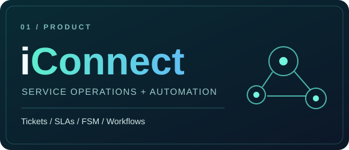

<div align="center">


<br>


<br>

<a href="https://www.linkedin.com/in/christopherataide">
  
</a>
<a href="https://www.linkedin.com/company/icodev-tech">
  
</a>
<a href="https://github.com/chriisataide?tab=repositories">
  
</a>

<br><br>


<br><br>

**Software Engineering** &nbsp; • &nbsp; **Artificial Intelligence** &nbsp; • &nbsp; **Automation** &nbsp; • &nbsp; **Data**

</div>

---

### `01 / ABOUT ME` &nbsp; 👨‍💻

## Engenharia com propósito. Inovação aplicada à operação.

Sou **Christopher Ataide**, **CEO & Founder da iCodev Tecnologia e Inovação**, **Software Architect**, **Full Stack Developer** e **AI Engineer**.

Com **mais de 5 anos de experiência** no desenvolvimento de sistemas empresariais, atuo da arquitetura à implantação de produtos que conectam **software, inteligência artificial, automação e dados**.

Meu foco é transformar processos manuais e operações complexas em **plataformas confiáveis, escaláveis e úteis no dia a dia**.

> **Software não deve apenas funcionar. Deve resolver problemas reais.**

<br>

### `02 / EXPERTISE` &nbsp; 🧠

<table>
<tr>
<td width="50%" valign="top">

#### 🏗️ Software Architecture
SaaS, sistemas corporativos, APIs, integrações, aplicações multi-tenant e soluções em tempo real.

</td>
<td width="50%" valign="top">

#### 🤖 Artificial Intelligence
AI Agents, copilotos, automação inteligente e integração de IA a processos empresariais.

</td>
</tr>
<tr>
<td width="50%" valign="top">

#### 📊 Operational Intelligence
Dashboards, indicadores, BI, dados operacionais e apoio à tomada de decisão.

</td>
<td width="50%" valign="top">

#### 👁️ Computer Vision
Análise de vídeo, detecção de eventos, monitoramento e inteligência visual.

</td>
</tr>
</table>

<br>

### `03 / FEATURED PRODUCTS` &nbsp; 🚀

<table>
<tr>
<td width="50%" valign="top">

<br>
<strong>iConnect · Gestão de serviços e operações</strong>
<br><br>
Plataforma empresarial para <strong>tickets, SLAs, ativos, equipes em campo, projetos, workflows e automações</strong>.
<br><br>
<code>Python</code> <code>Django</code> <code>DRF</code> <code>PostgreSQL</code> <code>Redis</code> <code>Docker</code>
</td>
<td width="50%" valign="top">

<br>
<strong>iAnalytical · Visão computacional e dados</strong>
<br><br>
Inteligência operacional baseada em <strong>análise de vídeo, detecção de eventos, dashboards e indicadores</strong>.
<br><br>
<code>Python</code> <code>Computer Vision</code> <code>AI</code> <code>Analytics</code> <code>BI</code>
</td>
</tr>
</table>

<br>

### `04 / TECH STACK` &nbsp; ⚙️

<div align="center">

**LANGUAGES & FRAMEWORKS**


<br><br>

**DATA, INFRASTRUCTURE & TOOLS**


</div>

<br>

### `05 / GITHUB INSIGHTS` &nbsp; 📈

<div align="center">


<br>

<sub>Os indicadores são calculados por serviços externos sobre dados públicos do GitHub e podem sofrer limites temporários de disponibilidade.</sub>

</div>

<br>

### `06 / CURRENT MISSION` &nbsp; 🎯

```text
$ cat focus.txt

[01] Enterprise AI & autonomous agents
[02] Workflow automation & integrations
[03] Computer vision & operational analytics
[04] Scalable, secure software architecture
[05] Products that create measurable value
```

<br>

### `07 / PHILOSOPHY` &nbsp; 💭

<div align="center">

### “Software não deve apenas funcionar.
### Deve resolver problemas reais.”

**Build with purpose. Engineer for scale. Deliver real impact.**

<br>

<a href="https://www.linkedin.com/in/christopherataide">
  
</a>

<br><br>

<sub>Designed with purpose · Christopher Ataide · iCodev Tecnologia e Inovação · 2026</sub>

</div>
