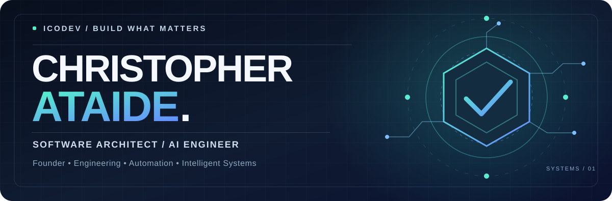
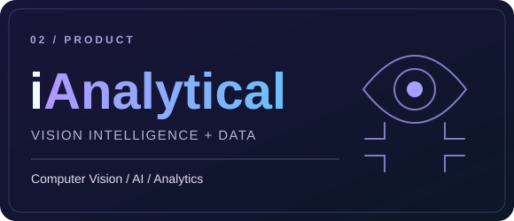

<div align="center">



<br>

<a href="https://www.linkedin.com/in/christopherataide"></a>
<a href="https://www.linkedin.com/company/icodev-tech"></a>
<a href="https://github.com/chriisataide?tab=repositories"></a>

<br><br>

**Transformo processos complexos em experiências digitais inteligentes.**  
`ENGINEERING` &nbsp; `ARTIFICIAL INTELLIGENCE` &nbsp; `AUTOMATION` &nbsp; `DATA`

</div>

---

### `01 / WHO I AM` &nbsp; 👨‍💻

## Tecnologia que funciona além do código.

Sou **Christopher Ataide**, **CEO & Founder da iCodev Tecnologia e Inovação**, **Software Architect**, **Full Stack Developer** e **AI Engineer**.

Tenho **mais de 5 anos de experiência** no desenvolvimento de soluções empresariais. Meu trabalho conecta **estratégia, arquitetura, engenharia e operação** — da identificação do problema ao deploy de sistemas confiáveis.

> **A tecnologia tem valor quando resolve problemas reais.**

<br>

### `02 / WHAT I BUILD` &nbsp; 🧩

| 🏗️ **Software Engineering** | 🤖 **Applied AI** |
| :--- | :--- |
| Arquitetura escalável, SaaS, APIs, integrações, aplicações multi-tenant e sistemas em tempo real. | AI Agents, copilotos, workflows inteligentes e IA integrada a processos corporativos. |
| 📊 **Operational Intelligence** | 👁️ **Computer Vision** |
| Dashboards, métricas, BI, automação e análise de dados para tomada de decisão. | Detecção de eventos, análise de vídeo, monitoramento e inteligência visual. |

<br>

### `03 / FEATURED PRODUCTS` &nbsp; 🚀

<table>
<tr>
<td width="50%" valign="top">

<br>
<strong>Gestão de serviços e operações</strong><br><br>
Tickets, SLAs, ativos, field service, projetos e automações em uma plataforma empresarial integrada.<br><br>
<code>Python</code> <code>Django</code> <code>PostgreSQL</code> <code>Redis</code> <code>Docker</code>
</td>
<td width="50%" valign="top">

<br>
<strong>Visão computacional e analytics</strong><br><br>
Inteligência sobre fluxos de vídeo e dados, com identificação de eventos, dashboards e indicadores operacionais.<br><br>
<code>Python</code> <code>Computer Vision</code> <code>AI</code> <code>Analytics</code>
</td>
</tr>
</table>

<br>

### `04 / TECHNOLOGY STACK` &nbsp; ⚡

<div align="center">

**Languages & Frameworks**


<br><br>

**Data, Infrastructure & Tools**


</div>

<br>

### `05 / CURRENT MISSION` &nbsp; 🎯

```text
> Designing intelligent software for real-world operations.

  [01] Enterprise AI & autonomous agents
  [02] Workflow automation & integrations
  [03] Computer vision & operational analytics
  [04] Scalable, secure software architecture
  [05] Products that create measurable value
```

<br>

### `06 / PHILOSOPHY` &nbsp; 💭

<div align="center">

### “Software não deve apenas funcionar.
### Deve resolver problemas reais.”

**Build with purpose. Engineer for scale. Deliver real impact.**

<br>

<a href="https://www.linkedin.com/in/christopherataide"></a>

<br><br>

<sub>Designed with purpose • Christopher Ataide © 2026</sub>

</div>
